# JavaVisual_TrismanJunnedyEphaproditusGulo_253303621217

# Character Manager — TP3 (Java Visual SIH-6406)

Proyek ini merupakan implementasi fondasi *class model* Java untuk aplikasi **Character Manager** pada Sprint #1. Aplikasi ini dibangun mengimplementasikan konsep dasar Pemrograman Berbasis Objek (OOP) seperti *Encapsulation*, *Type Safety* dengan Enum, *Constructor Overloading*, serta validasi atribut kondisi (*exception handling*).

---

## 📌 Screenshot Output Terminal

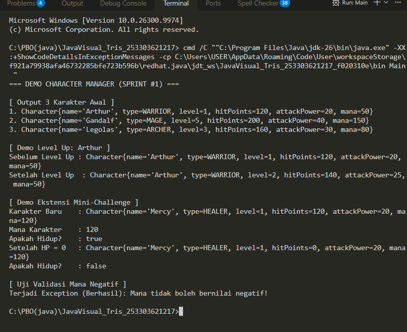
---

## 📁 Struktur Folder Project

```text
javavisual-tp03-[NIM]/
├── README.md
└── CharacterManager/
    └── src/
        ├── Main.java
        └── com/
            └── unpri/
                └── charactermanager/
                    └── model/
                        ├── Character.java
                        └── CharacterType.java

```
---

# Character Manager Java Visual TP5

---
Nama: Trisman Junnedy Ephaproditus Gulo
NIM: 253303621217
Kelas: Sistem Informasi / Java Visual (SIH-6406)
Dosen Pengampu: Dr. Evta Indra


---


## Ringkasan Proyek
Proyek ini merupakan pengembangan lanjutan dari modul Character Manager (Sprint #2 / TP5). Fokus utama pengerjaan meliputi penerapan prinsip Pemrograman Berorientasi Objek di Java, validasi data, enkapsulasi memori, serta penanganan koleksi data secara aman.

---

## Struktur dan Implementasi Fitur
1. Core Implementation (Bagian A):
- Character.java: Mengimplementasikan method equals() yang dioverride untuk membandingkan kesamaan nama karakter secara case-insensitive.
- CharacterManager.java: Menyediakan method addCharacter() dengan pencegahan duplikasi nama, findByName(), removeCharacter(), getTotalCharacters(), serta getAllCharacters() yang menerapkan Defensive Copying agar list internal terlindungi dari modifikasi luar.

2. Mini-Challenge (Bagian B):
- getAverageLevel(): Menghitung rata-rata level seluruh karakter secara akurat dan dilengkapi pengaman kondisi list kosong (mencegah error pembagian dengan nol).
- findByType(CharacterType): Menyaring dan mengembalikan daftar karakter berdasarkan tipe tertentu.

3. Fitur Analitik Mandiri (Bagian C):
- renameCharacter(oldName, newName): Method rancangan sendiri untuk mengubah nama karakter dengan validasi ketat terhadap nama kosong dan pencegahan bentrok nama dengan karakter lain yang sudah ada.

## Analisis dan Dokumentasi (Bagian D)
- Tautan Dokumen Analisis Google Docs: https://docs.google.com/document/d/17mQVz4Sup2ySj154_-H6PZ7psDAkIZMqWyOgDwHO_bQ/edit?usp=sharing


## Screenshot Output Program
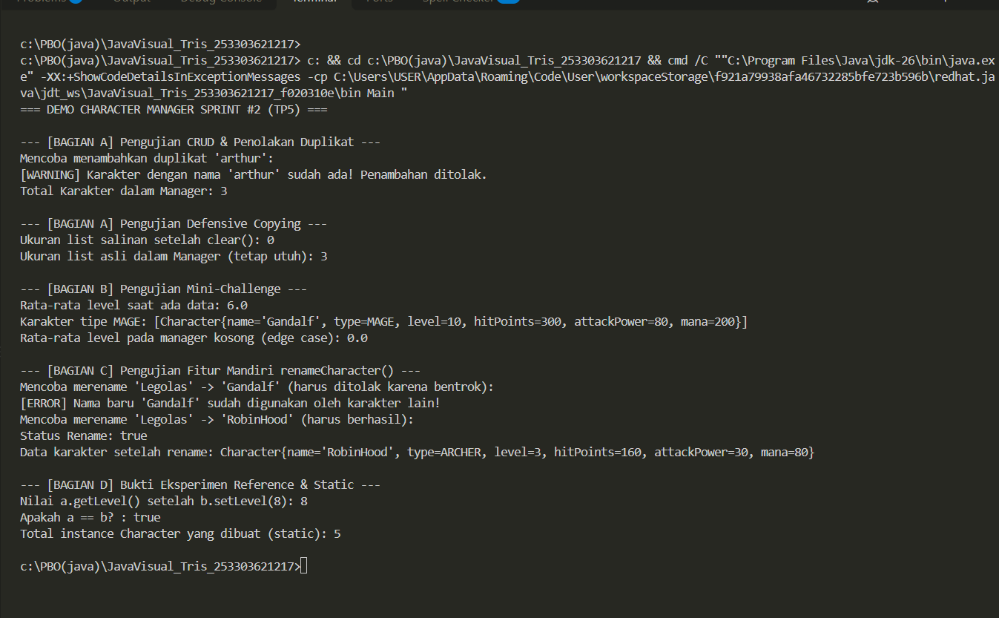

---
---

## TP8 — Character Manager Sprint #3 (MainWindow, Data Dinamis & MVC)

---

### 1. Aliran Data MVC (Main -> CharacterManager -> MainWindow)
Dalam arsitektur MVC yang diterapkan, kelas Main berperan sebagai Controller yang menginisialisasi objek CharacterManager (Model) beserta seluruh data karakter awal. Selanjutnya, Main menjalankan MainWindow (View) melalui SwingUtilities.invokeLater() dengan meneruskan referensi CharacterManager. MainWindow kemudian membaca salinan daftar karakter secara dinamis melalui perulangan (loop) untuk merender kartu komponen GUI dan memperbarui label statistik rata-rata level tanpa manipulasi data langsung.

### 2. Daftar Karakter Baru dan Alasan Pemilihan
- Mercy (Tipe: HEALER, Level: 7): Ditambahkan untuk melengkapi keragaman peran karakter pendukung (support) dan menguji tampilan dinamis dengan atribut mana yang tinggi.
- Shadow (Tipe: MAGE, Level: 12): Ditambahkan sebagai representasi karakter level tinggi guna menguji akurasi perhitungan rata-rata level pada label statistik di bagian bawah jendela.
- Ragnar (Tipe: WARRIOR, Level: 15): Digunakan pada pengujian kedua untuk membuktikan bahwa statistik rata-rata level otomatis berubah secara dinamis ketika data bertambah.

### 3. Link Dokumen Analisis GUI & MVC (Bagian D)
- Google Docs Analisis TP8: https://docs.google.com/document/d/1qUnXGoD2E3CNBsIdRjVAdcjbK1R4Dc9eFBOgiXzSOuU/edit?usp=sharing
(Akses dokumen diatur ke: Anyone with the link Viewer)

### 4. Screenshots MainWindow (Sebelum & Sesudah Perubahan Data)
- Screenshot 1 (5 Karakter — Rata-rata Level 7.40):
  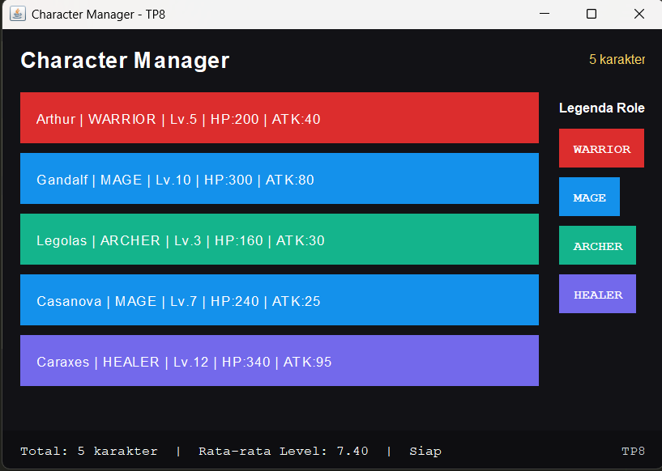
- Screenshot 2 (6 Karakter — Rata-rata Level 8.67):
  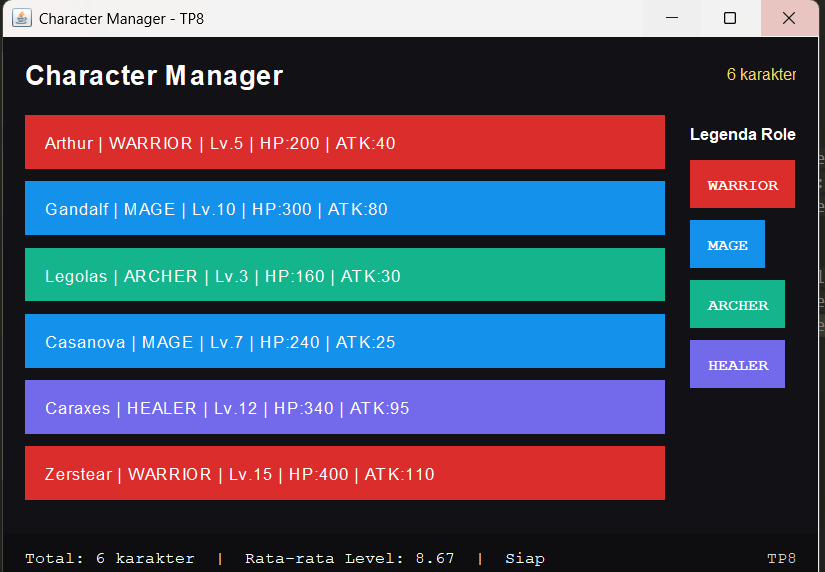

  ---
---

## TP10 — Character Manager Sprint #4 (Theming, Properti Komponen & Analisis MVC)

---

### 1. Pemisahan Tanggung Jawab MVC (`AppTheme` vs `Character`)
Pemetaan warna, font, dan border ditempatkan pada kelas `AppTheme` di package `view` dan bukan di kelas `Character` (package `model`) karena aturan tampilan merupakan tanggung jawab eksklusif layer **View**. Kelas `Character` harus tetap bersih sebagai representasi data domain dan logika bisnis murni tanpa bergantung pada pustaka grafis seperti `java.awt.Color` atau `javax.swing`. Pemisahan ini memastikan kelas `Model` tetap dapat diuji secara independen, digunakan ulang pada antarmuka non-GUI (konsol/API), serta memudahkan perubahan tema visual secara terpusat tanpa menyentuh kode model data.

### 2. Dua Properti Tambahan pada Komponen Swing
1. **Tooltip Detail Statistik (`setToolTipText` pada Kartu Karakter & Label):**
   Menampilkan informasi lengkap atribut karakter (termasuk nilai **Mana** dan status **Aktif/Gugur**) saat kursor diarahkan ke kartu, sehingga tampilan kartu utama tetap ringkas dan bersih tanpa kehilangan detail data.
2. **Border Aksen Per Role (`setBorder` melalui `AppTheme.cardBorderFor`):**
   Memberikan bingkai garis berwarna terang (`CompoundBorder` dari `LineBorder` dan `EmptyBorder`) yang disesuaikan dengan tipe peran (`WARRIOR`, `MAGE`, `ARCHER`, `HEALER`) untuk mempertegas batas antarkartu dan meningkatkan kontras visual pada tema gelap.

### 3. Link Dokumen Analisis Properti & MVC (Bagian D)
- Google Docs Analisis TP10: https://docs.google.com/document/d/11Qa_UXXJoiGBNjw51p9qiAKPdALLuSt-ga3dNazZBFI/edit?usp=sharing
  *(Akses diatur ke: Anyone with the link — Viewer)*

### 4. Screenshots MainWindow (Sebelum v0.3 & Sesudah v0.4)
- **Screenshot 1 — Sebelum (v0.3 / Tanpa AppTheme & Tanpa Highlight Level Tinggi):**
  
- **Screenshot 2 — Sesudah (v0.4 / Dengan AppTheme, Highlight Emas Level ≥ 5, & Border Per Role):**
  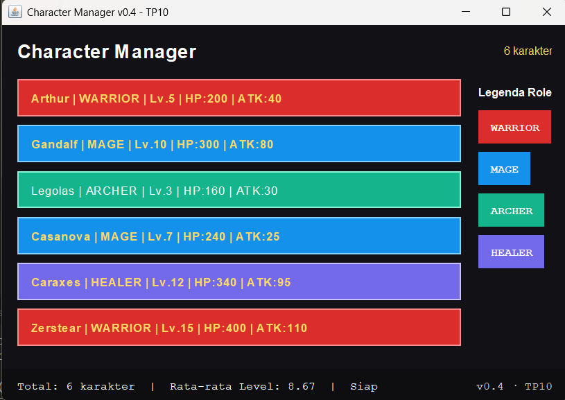

---
---
 ## TP12 — Character Manager Sprint #5 (Layout, UI Responsif & Analisis MVC)

### 1. Wireframe Tata Letak (`MainWindow v0.5`)

```text
+-----------------------------------------------------------------------+
|                       CHARACTER MANAGER (Header)                      |  <- NORTH
| [Total Karakter: 8]                         [Rata-rata Level: 7.75]   |  <- GridLayout(2,2)
| [Karakter Elite (Lv>=5): 6]                     [HP Tertinggi: 420]   |
+---------------------------------------------------+-------------------+
| +-----------------------------------------------+ | LEGENDA ROLE      |
| | Arthur (WARRIOR - Merah Terang)         ALIVE | | [WARRIOR]         |
| +-----------------------------------------------+ | [MAGE]            |  <- EAST
| | Gandalf (MAGE - Ungu Terang)            ALIVE | | [ARCHER]          |     (BoxLayout
| +-----------------------------------------------+ | [HEALER]          |      Y_AXIS)
| | Legolas (ARCHER - Biru Terang)          ALIVE | |                   |
| +-----------------------------------------------+ | (Vertical Glue)   |
| | ... (JScrollPane berisi daftar kartu) ...     | | *Emas = Level >=5 |
+---------------------------------------------------+-------------------+
| Zerstear Berhasil Ditambahkan                                    v0.5 |  <- SOUTH
+-----------------------------------------------------------------------+

```
### 2. Struktur Panel Bersarang (Nested Panels)
Jendela utama `MainWindow` menggunakan `BorderLayout` sebagai kerangka utama dengan empat wilayah aktif (`NORTH`, `CENTER`, `EAST`, dan `SOUTH`). Wilayah `NORTH` berisi panel pembungkus `BorderLayout` yang menggabungkan judul aplikasi di atas dan panel statistik `GridLayout(2, 2)` di bawahnya. Wilayah `CENTER` menampung `JScrollPane` yang membungkus `scrollWrapperPanel` (`BorderLayout`), di mana `cardsGridPanel` (`GridLayout(0, 1)`) diletakkan pada posisi `NORTH` agar tinggi kartu karakter tetap proporsional dan tidak melar saat jendela diperbesar. Sementara itu, wilayah `EAST` menggunakan `BoxLayout` vertikal untuk legenda role, dan wilayah `SOUTH` memakai `BorderLayout` untuk memisahkan pesan status di kiri dan label versi `"v0.5"` di kanan.

### 3. Alasan Panel Tambahan dan Layout yang Ditolak
Panel tambahan yang dipilih adalah `GridLayout(2, 2)` di wilayah `NORTH` untuk menampilkan empat metrik ringkasan statistik karakter (Total Karakter, Rata-rata Level, Jumlah Karakter Elite, dan HP Tertinggi) dalam dua baris dan dua kolom yang sejajar rapi tanpa memakan banyak ruang vertikal. Sementara itu, `FlowLayout` ditolak untuk panel statistik ini karena `FlowLayout` akan membungkus komponen ke baris baru secara tidak teratur ketika jendela dikecilkan, sehingga merusak kesejajaran kolom statistik kiri dan kanan.

### 4. Tabel Pengamatan Resize (Prediksi vs Hasil)
| Kondisi Jendela | Prediksi Perilaku Layout | Hasil Aktual Saat Dijalankan |
| :--- | :--- | :--- |
| **Ukuran Awal (`pack()`)** | Jendela membuka sesuai ukuran ideal komponen; 4 wilayah `BorderLayout` terlihat lengkap dan seluruh kartu tertata rapi. | Sesuai prediksi. Jendela muncul pas di tengah layar dengan seluruh elemen terbaca jelas tanpa ruang kosong berlebih. |
| **Jendela Dilebarkan & Dipertinggi** | Wilayah `CENTER` melebar ke samping mengikuti lebar jendela, tinggi kartu tetap stabil (tidak melar), dan `EAST` tetap selebar legenda. | Sesuai prediksi. Kartu melebar secara horizontal dengan rapi, tinggi kartu tetap proporsional berkat pembungkus `BorderLayout.NORTH`, dan legenda tetap merapat ke atas karena *vertical glue*. |
| **Jendela Dikecilkan (Tinggi Dikurangi)** | `NORTH`, `SOUTH`, dan `EAST` tetap bertahan pada ukuran aslinya, sementara `CENTER` menyusut dan memunculkan *scrollbar* vertikal. | Sesuai prediksi. Header, statistik, dan bar status tidak terpotong, sedangkan daftar kartu di tengah otomatis memunculkan *scrollbar* untuk menggulir karakter ke bawah. |

### 5. Link Dokumen Analisis Layout & MVC (Bagian D)
Google Docs Analisis TP12: https://docs.google.com/document/d/1HfP8PnjSwDrjxAJ1-bG8nqeJo_hy3RHBwxiR2OKHX2U/edit?usp=sharing
### 6. Screenshots Pengujian Responsivitas (v0.5)
**Ukuran Awal (`pack()`):**
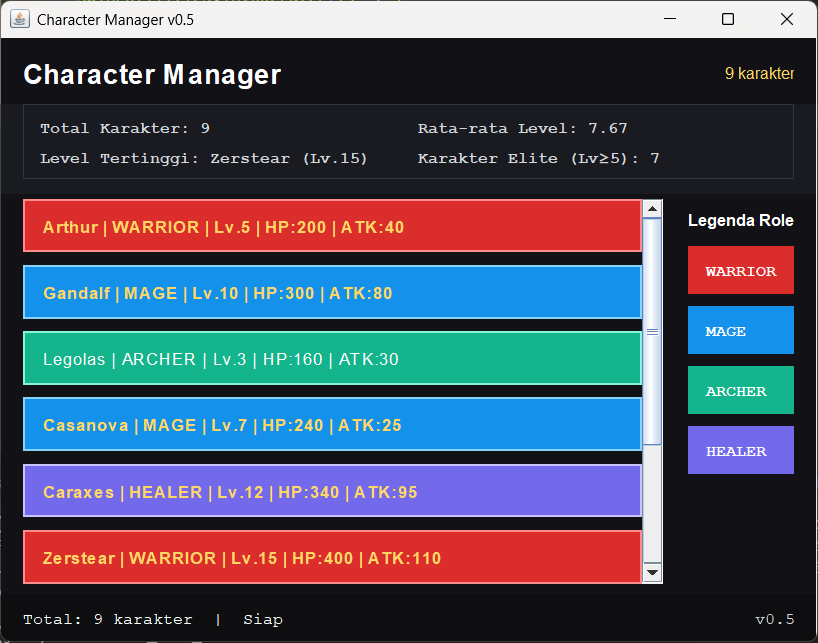

**Jendela Dilebarkan:**
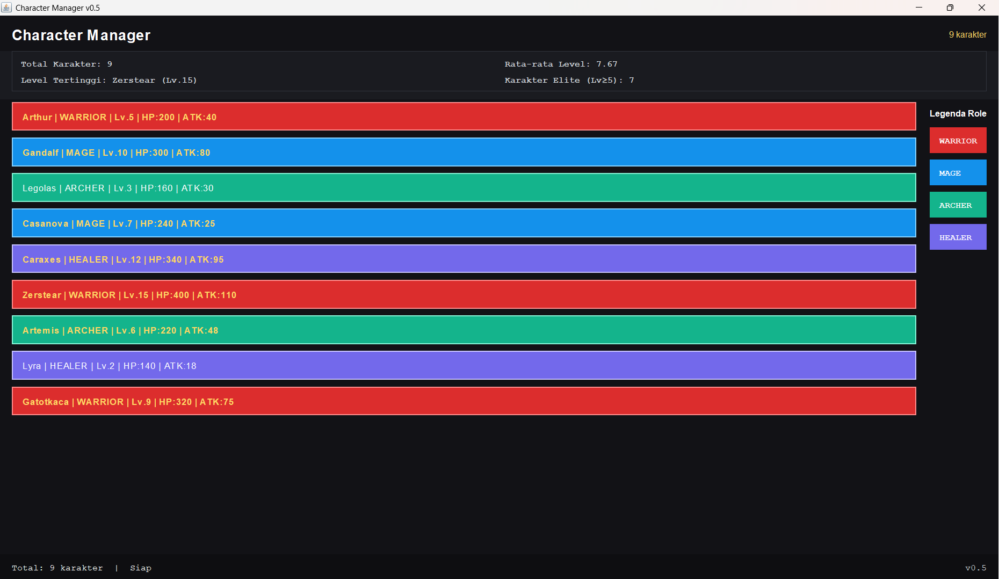

**Jendela Dikecilkan (Scrollbar Muncul):**
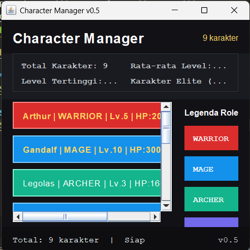

---
---
# Character Manager — TP14 (Sprint #6: Form Input, Validasi & Analisis MVC)

Aplikasi desktop berbasis **Java Swing** (`Character Manager v0.6`) dengan arsitektur **MVC (Model–View–Controller)** untuk mengelola daftar karakter, statistik tim, serta validasi input form berlapis (`View` dan `Model`).

---

## TP14 — Form Input, Validasi & Arsitektur MVC

---

### 1. Pemisahan Lapisan & Aturan Validasi
- **Lapisan View (`CharacterFormPanel`, `MainWindow`, `AppTheme`)**:
  - `CharacterFormPanel` menggunakan `JTextField` (nama), `JComboBox<CharacterType>` (role), dan `JSpinner` (level `1–99`), serta menyeragamkan warna, tata letak, dan border error (`AppTheme.BORDER_INPUT_ERROR`) melalui `AppTheme`.
  - `validateName(...)` memeriksa input secara berurutan (**kelengkapan → panjang → format → keunikan**) dan hanya mengembalikan pesan/hasil validasi tanpa menyentuh komponen UI secara langsung.
  - Input nama dibersihkan dengan `trim()`, nilai `JSpinner` dibaca setelah `commitEdit()`, error ditampilkan secara *inline* dengan border merah dan fokus kembali ke field terkait, lalu border asli dipulihkan saat input valid.
  - Karakter yang lolos validasi langsung ditambahkan dan daftar diperbarui melalui `refreshList()` dengan `revalidate()` dan `repaint()` sehingga kartu karakter dan statistik langsung terbarui di layar.
- **Lapisan Model (`Character`, `CharacterType`, `CharacterManager`)**:
  - Tidak memiliki dependensi `javax.swing` atau `java.awt`.
  - Aturan domain pada `Character` menolak nama kosong, *role* `null`, level di luar `1–99`, serta menegakkan **Mini-Challenge: level `MAGE` tidak boleh melebihi `60`** dengan melempar `IllegalArgumentException` (pesannya diteruskan dan ditampilkan di form tanpa mengubah `CharacterFormPanel`).
  - `CharacterManager` menyediakan `isNameTaken()` serta memvalidasi kapasitas maksimum (`MAX_CHARACTERS = 20`) dan keunikan nama di lapisan *model*.

### 2. Dua Aturan Validasi Tambahan & Alasan Penempatannya
1. **Larangan nama yang diawali spasi ganda (`View` — `CharacterFormPanel`)**:
  - **Alasan di `View`**: Aturan ini berkaitan dengan format input teks mentah pada antarmuka pengguna sebelum nilai dibersihkan dan dibentuk menjadi objek domain.
2. **Batas maksimal 20 karakter dalam total daftar (`Model` — `CharacterManager.MAX_CHARACTERS`)**:
  - **Alasan di `Model`**: Batas kapasitas koleksi karakter merupakan aturan integritas data domain milik `CharacterManager` agar jumlah data selalu konsisten dari pemanggil mana pun.

### 3. Kompromi Sementara pada Sprint #6
Pada implementasi Sprint #6 (`v0.6`), penanganan *event* tombol/form menggunakan `ActionListener` minimal dan `CharacterFormPanel` memanggil langsung alur penambahan ke `CharacterManager` melalui *callback* dari `MainWindow`. Kompromi ini dipilih agar pengujian validasi *inline*, pembaruan daftar (`refreshList()`), dan pelaporan status dapat berjalan cepat dan transparan pada tahap ini. Selanjutnya, alur koordinasi akan dirapikan agar *view* tidak bergantung langsung pada pemanggilan *manager*.

### 4. Dokumen Analisis Bagian D (Google Docs)
- **Nama Dokumen**: `JavaVisual_TP14_253303621217_Trisman Junnedy Ephaproditus Gulo`
- **Link Google Docs (Bagian D)**: [JavaVisual_TP14_253303621217_Trisman Junnedy Ephaproditus Gulo](https://docs.google.com/document/d/1MKqm98SNKuOg-53IBDwR3xzWJ4y0XrHDFbXmm1S_jiQ/edit?usp=sharing)

---

## Tabel Pengujian Validasi TP14

| No | Input | Hasil Diharapkan | Hasil Nyata | Lapisan yang Menangkap | Bukti *Screenshot* |
| :-: | :--- | :--- | :--- | :--- | :--- |
| 1 | Nama: `""` (kosong), Role: `WARRIOR`, Level: `1` | Border merah pada field Nama, pesan *error* *inline* muncul, fokus kembali ke field Nama, jumlah karakter tetap `9`. | Border merah muncul pada field **Nama**, pesan *error* *inline* tampil, fokus kembali ke field **Nama**, dan jumlah karakter tetap `9`. | `View` (`CharacterFormPanel.validateName`) | `Screenshot/TP14_ErrorKosong.png` |
| 2 | Nama: `"Casanova"` (sudah ada), Role: `WARRIOR`, Level: `1` | Border merah pada field Nama, pesan *error* duplikat muncul, karakter tidak ditambahkan. | Border merah muncul pada field **Nama**, pesan *error* nama duplikat tampil *inline*, dan jumlah karakter tetap `9`. | `View` (`isNameTaken`) & `Model` (`CharacterManager.addCharacter`) | `Screenshot/TP14_ErrorDuplikat.png` |
| 3 | Nama: `"Tyns"`, Role: `MAGE`, Level: `60` | Border kembali normal, pesan sukses tampil, kartu karakter baru muncul di daftar, statistik terbarui. | Border field **Nama** kembali normal, form ter-*reset* (`Nama` kosong, `Role: MAGE`, `Level: 1`), muncul pesan *"Berhasil menambahkan 'Tyns' (MAGE, Lv.60)."*, kartu `Tyns \| MAGE \| Lv.60 \| HP:1300 \| ATK:315` tampil di daftar, total menjadi `10 karakter`, `Rata-rata Level: 12.90`, `Level Tertinggi: Tyns (Lv.60)`, `Karakter Elite (Lv≥5): 8`, dan status bar menampilkan `Total: 10 karakter \| Siap` (`v0.6`). | Lolos `View` & `Model` (`MAGE` Lv.60 $\le$ 60) | `Screenshot/TP14_Sukses.png` |
| 4 | Nama: `"  TestSpasi"`, Role: `ARCHER`, Level: `5` | Ditolak dengan pesan *error* format/spasi ganda di awal nama, border merah aktif, data tidak masuk daftar. | Ditolak oleh validasi format nama pada form sebelum penambahan karakter; border merah dan pesan *error* *inline* tampil. | `View` (`CharacterFormPanel.validateName`) | — |
| 5 | Nama: `"A"`, Role: `WARRIOR`, Level: `5` | Ditolak karena panjang nama kurang dari batas minimum yang diizinkan, pesan *error* *inline* muncul. | Ditolak oleh validasi panjang nama pada form; pesan *error* *inline* dan border merah tampil. | `View` (`CharacterFormPanel.validateName`) | — |
| 6 | Nama: `"MageTest"`, Role: `MAGE`, Level: `61` | Ditolak karena level `MAGE` melebihi batas maksimal `60`; pesan dari `IllegalArgumentException` tampil di form. | Ditolak oleh aturan domain `MAGE` maksimal level `60` dan menampilkan pesan *error* di form tanpa mengubah `CharacterFormPanel`. | `Model` (`Character.validateCharacterAttributes`) | — |
| 7 | Nama: `"LevelTest"`, Role: `WARRIOR`, Level: `0` atau `100` | Ditolak karena level di luar rentang `1–99` (`IllegalArgumentException` / batas spinner). | Ditolak dengan pesan *error* rentang level valid (`1–99`) dan karakter tidak ditambahkan. | `Model` (`Character`) & `View` (`JSpinner` `1–99`) | — |
| 8 | Karakter ke-21 saat daftar sudah berisi `20` karakter (`MAX_CHARACTERS = 20`) | Ditolak karena kapasitas penuh (`maksimal 20 karakter`); pesan *error* kapasitas tampil di form. | Ditolak oleh `CharacterManager.addCharacter()` dengan `IllegalArgumentException` dan pesannya tampil di form. | `Model` (`CharacterManager.addCharacter`) | — |

### Catatan Hasil Uji & Tindakan Perbaikan
- Pengujian skenario sukses (`Tyns`, `MAGE`, Level `60`) mengonfirmasi bahwa batas maksimal level `60` untuk `MAGE` dapat diproses dengan baik, kartu karakter baru tampil dengan warna tema `MAGE` serta legenda *role* di sisi kanan, dan seluruh indikator statistik serta *status bar* (`v0.6`) ikut terbarui.
- Perbaikan sebelumnya pada deklarasi kelas yang sempat terduplikasi dan pemanggilan `Character.validateCharacterAttributes(...)` memastikan kompilasi berjalan bersih dan pesan dari `IllegalArgumentException` dapat diteruskan ke form.

---

## Tangkapan Layar TP14

### 1. Error Nama Kosong
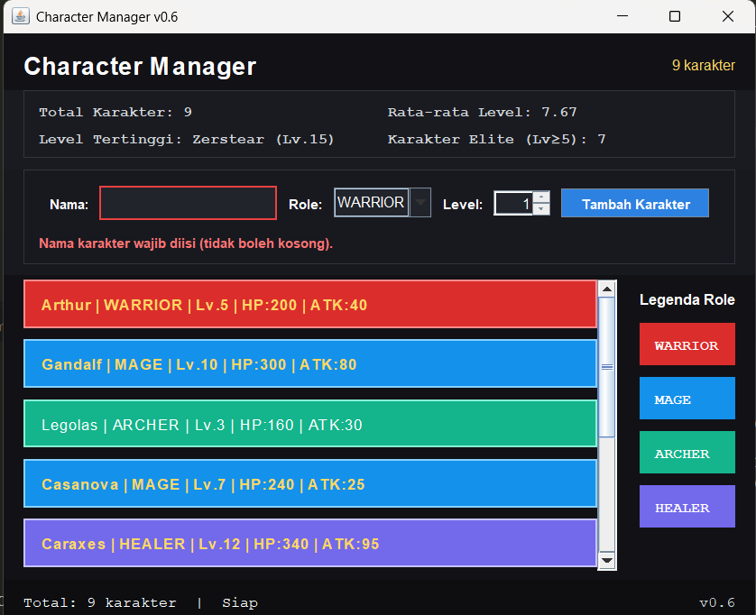

### 2. Error Nama Duplikat
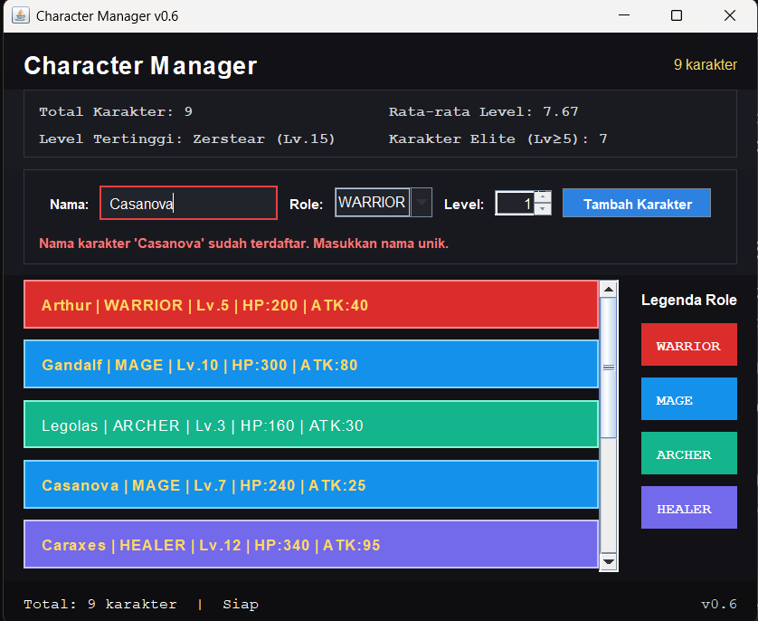

### 3. Sukses Menambahkan Karakter (`Tyns` — `MAGE` Lv.60)
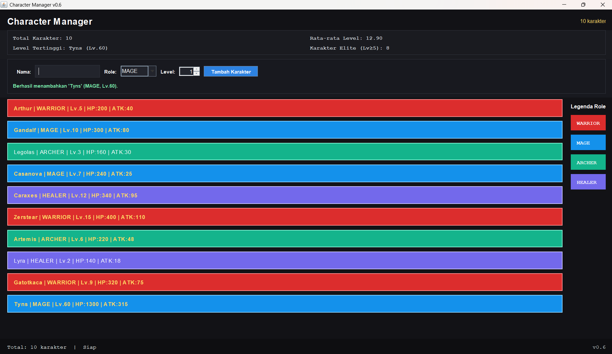